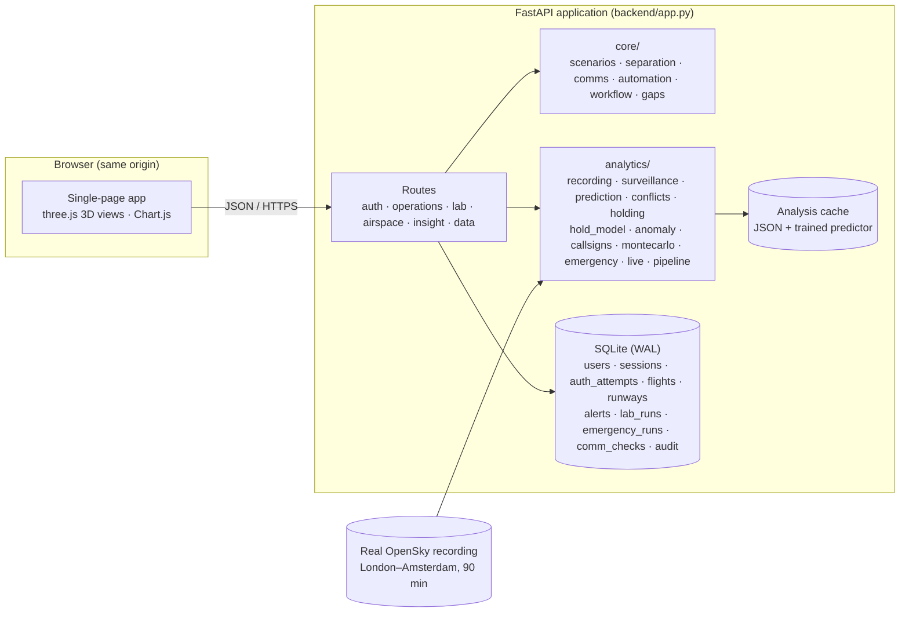

# Architecture

## Layers

| Layer | Modules | Responsibility |
|---|---|---|
| Presentation | `frontend/index.html`, `frontend/js/main.js`, `frontend/js/pages/*.js`, `frontend/js/scene3d.js` | Login portal, navigation, 3D airspace and scenario views, charts, forms |
| API | `backend/routes/*.py` | Authentication, validation, role checks, CSRF, audit, JSON responses |
| Decision engine | `backend/core/` | Scenario planning and exact conflict verification, readback verification, callsign similarity, automation policy, workflow model, gap catalogue |
| Analytics | `backend/analytics/` | Real-data analyses, learned models, Monte Carlo, emergency injection, live replay views; results cached by dataset hash and code version |
| Persistence | `backend/database.py`, `backend/schema.sql` | SQLite in WAL mode; every change audited |

## Request flow examples

**Login.** `POST /api/auth/login` → `auth.login` counts recent failures (username and IP), checks the PBKDF2
hash, writes an `auth_attempts` row with the reason, then either returns 401/429 with a uniform message or
creates a session (HTTP-only cookie + CSRF token).

**Scenario.** `POST /api/lab/runs` → `core.scenarios.build` plans both the comparator and the SkyControl routes,
verifies every pair with `separation.interval_conflict`, builds the ten-step pipeline, the context-switch log
(`automation.decide`), the message log (`comms.verify_readback`) and the workflow comparison (`workflow.compare`).
The run is stored in `lab_runs`; `GET /api/lab/runs/{id}` advances the replay clock, which stops at T+20 s until a
user with the required role approves.

**Emergency in real traffic.** `POST /api/airspace/emergency` → `analytics.emergency.plan` ranks airports, builds a
3-degree descent path, checks it against the recorded positions of all other aircraft, proposes level changes,
re-sequences real arrivals and drafts messages; the result is stored in `emergency_runs` and an alert is raised.

## Key algorithms

| Problem | Algorithm | Module |
|---|---|---|
| Exact conflict check of planned routes | Piecewise-linear relative motion; quadratic (horizontal) and linear (vertical) intervals intersected per segment pair | `core/separation.py` |
| Route around weather / protected airspace | Dijkstra on a 16-node visibility graph around the buffered circle | `core/separation.py` |
| Converging traffic | Greedy flight-level assignment with all-pairs verification | `core/scenarios.py` |
| Arrival sequencing | Priority-first ordering with holding-circuit search, 120 s spacing and closure windows | `core/scenarios.py` |
| Trajectory prediction | Gradient-boosted residual correction of straight-line extrapolation (along/cross track), temporal split | `analytics/prediction.py` |
| Conflict probe | Sampled 5-min prediction with learned paths, cleared-level intent, duplicate merging and hysteresis | `analytics/conflicts.py` |
| Duplicate targets | 24-bit address bit errors, same callsign, anonymous co-location | `analytics/surveillance.py` |
| Holding | Accumulated turn >= 330 deg in 8 min, nearest published stack | `analytics/holding.py` |
| Hold prediction | Logistic regression on real labels, 30-80 NM before the stack | `analytics/hold_model.py` |
| Emergency-like behaviour | Isolation forest + vertical-rate rule (hybrid) + cleared-level adherence | `analytics/anomaly.py` |
| Readback verification | Token-level parser (digits, NATO alphabet, telephony) and field comparison with dropped-digit tolerance | `core/comms.py` |
| Context switch | Rule policy over severity, confidence, data quality, disagreement, security, novelty | `core/automation.py` |

## Security

* PBKDF2-SHA256 (310,000 iterations, per-user salt); no default passwords in code.
* Opaque random session tokens stored as SHA-256 hashes; HTTP-only, SameSite=Lax cookies; 12-hour expiry.
* CSRF token required for every cookie-authenticated change; bearer tokens for API clients and tests.
* Lockout: 7 failures per username or 40 per IP in 15 minutes; every attempt stored with its reason.
* Role checks: supervisors approve critical plans, overrides (with a reason), runway closures, user management, audit access.
* Security headers: CSP (`script-src 'self'`), X-Frame-Options DENY, nosniff, no-referrer, no-store for API; HSTS with `SKYCONTROL_HTTPS=1`.
* Container runs as an unprivileged user.
